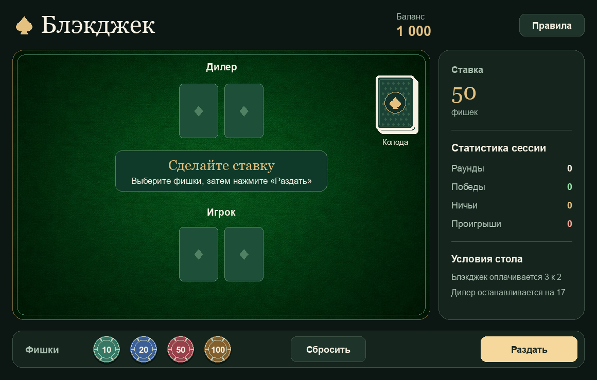
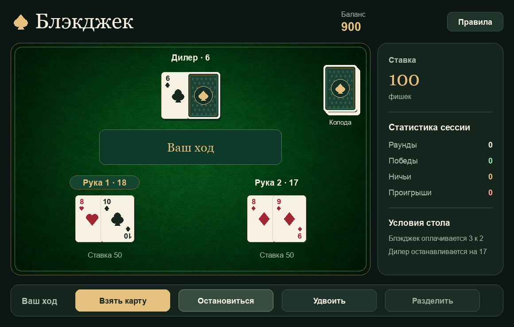

# Блэкджек

- **Авторы:** Цхай Владислав и Погосян Самвел
- **Группа Владислава:** ПИ25-2
- **Дисциплина:** Практикум по программированию
- **Дата сдачи:** не указана

## Описание проекта

«Блэкджек» — настольная игра против дилера на Python и Pygame. Игрок
ставит виртуальные фишки, принимает решения по каждой руке и следит
за балансом и результатами сессии.

## Возможности

- Анимированная раздача и переворот закрытой карты дилера.
- Четыре номинала фишек и повтор предыдущей ставки между раундами.
- Добор, остановка, удвоение ставки и разделение пары на две руки.
- Подсчёт очков с гибкой стоимостью туза, расчёт ставок и статистика.
- Правила внутри игры, управление мышью и клавиатурой, изменение размера окна.

## Демонстрация





## Требования к системе

- Python 3.10–3.13 с `venv` и `pip`. Проект проверен на Python 3.12.
- Pygame 2.6.1.
- Windows, macOS или Linux с графической средой.
- Git для клонирования репозитория.

## Установка и запуск

1. Клонируйте проект и перейдите в его папку.

   ```bash
   git clone https://github.com/icebergfire/blackjack.git
   cd blackjack
   ```

2. Создайте и активируйте виртуальное окружение.

   Windows, командная строка

   ```bat
   py -3.12 -m venv venv
   venv\Scripts\activate.bat
   ```

   macOS или Linux

   ```bash
   python3.12 -m venv venv
   source venv/bin/activate
   ```

3. Установите зависимости и запустите игру.

   ```bash
   python -m pip install -r requirements.txt
   python main.py
   ```

### Управление

| Клавиша | Действие |
| --- | --- |
| `1`, `2`, `3`, `4` | Добавить к ставке 10, 20, 50 или 100 фишек |
| `Backspace` | Сбросить ставку до раздачи |
| `Пробел` | Взять карту во время своего хода |
| `D` | Удвоить ставку, если действие доступно |
| `S` | Разделить пару, если действие доступно |
| `Enter` | Раздать карты, остановиться или перейти к следующему раунду |
| `F1` | Открыть правила |
| `Esc` | Закрыть правила или выйти из игры |

Все действия доступны мышью.

## Правила стола

- Игрок начинает с 1 000 фишек. Блэкджек из первых двух карт приносит
  чистый выигрыш в размере 3 к 2, обычная победа — 1 к 1. При ничьей
  ставка возвращается.
- Туз даёт 1 или 11 очков. Валет, дама и король дают 10. При сумме
  больше 21 рука проигрывает. Если подходят оба значения туза, стол
  показывает обе суммы, например `7 / 17` для туза и шестёрки.
- Дилер останавливается при любой сумме не меньше 17, включая туза с
  шестёркой. Блэкджек проверяется после начальной раздачи.
- Две карты одного ранга можно один раз разделить за дополнительную
  ставку. Разделённые тузы получают по одной карте. Удвоение на двух
  картах стоит ещё одну ставку и завершает ход после добора одной карты.
- Статистика учитывает итог раунда по изменению баланса. Результаты
  разделённых рук отображаются отдельно на столе.

Справочник по основным правилам. [Правила блэкджека NJ Division of Gaming Enforcement](https://www.nj.gov/lps/ge/docs/Regulations/CHAPTER69F.pdf)

## Структура проекта

```text
blackjack/
├── main.py              # Окно, ввод и главный цикл
├── game.py              # Карты, ставки, правила и статистика
├── graphics.py          # Интерфейс и анимация
├── assets/felt.jpg      # Текстура сукна
├── screenshots/         # Демонстрация стола и хода игрока
├── tests/test_game.py   # Проверки правил
├── requirements.txt
└── README.md
```

Правила и расчёты вынесены из интерфейса. Их можно проверять без запуска
графического окна.

```bash
python -m unittest discover -s tests -v
```

## Пример использования

Выберите фишку 50 и нажмите «Раздать». Если у вас две восьмёрки, нажмите
«Разделить», чтобы разыграть две руки. Стол спишет ещё 50 фишек, добавит
по карте в каждую руку и выделит текущую. Когда обе руки сыграны, дилер
откроет свою карту, а стол рассчитает выплаты.
